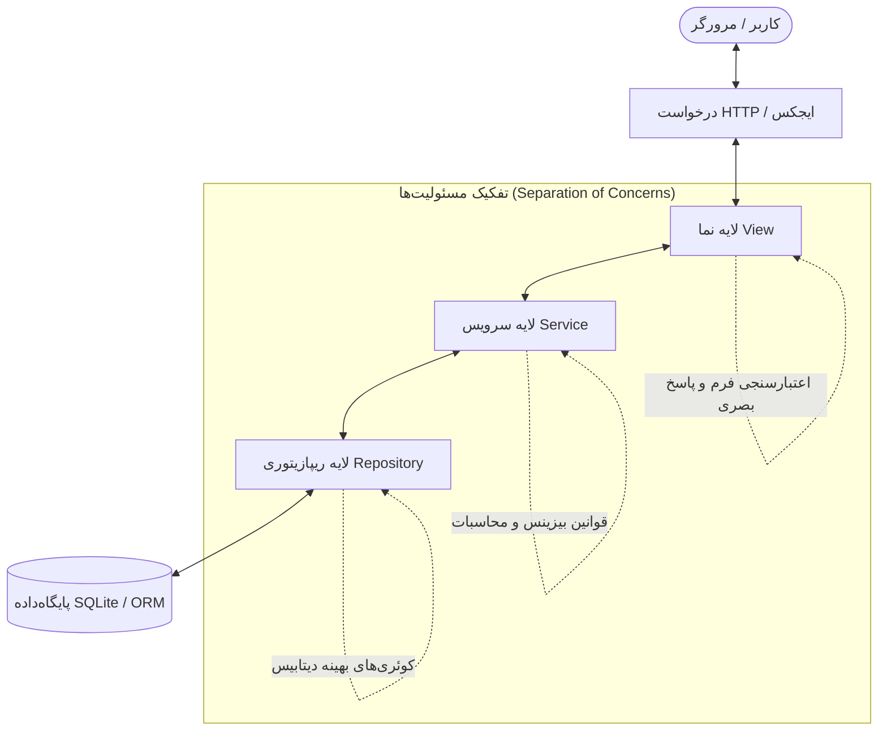

# راهنمای توسعه و استانداردهای مهندسی دَندی (DEVELOPMENT.md)

این سند راهنمای جامع معماری، استانداردهای کدنویسی، الگوهای طراحی و شیوه توسعه قابلیت‌های جدید در پروژه **دَندی (Dandi)** است.

---

## 🏛️ ۱. اصول معماری نرم‌افزار (Clean Layered Architecture)

در این پروژه به جای استفاده از رویکرد سنتی جنگو که منجر به مدل‌های چاق (Fat Models) یا ویوهای حجیم (Fat Views) می‌شود، از الگوی سه‌لایه منسجم استفاده شده است:



### قانون تک‌مسئولیتی و تفکیک فایل‌ها (One Class, One File)
در دَندی، هیچ کلاسی با کلاسی دیگر در یک فایل مشترک انباشته نمی‌شود:
- هر فرم در فایل خودش (مثال: `forms/register_form.py`)
- هر مدل در فایل خودش (مثال: `models/article.py`, `models/category.py`)
- هر ریپازیتوری در فایل خودش (مثال: `repositories/article_repository.py`)
- هر سرویس در فایل خودش (مثال: `services/article_service.py`)
- هر نما در فایل خودش (مثال: `views/home_view.py`, `views/article_detail_view.py`)

---

## 🧩 ۲. شرح لایه‌های سه‌گانه

### الف) لایه ریپازیتوری (Repository Layer)
- **مسئولیت**: تنها لایه‌ای است که مجاز به نوشتن کوئری‌های ORM جنگو (`filter()`, `select_related()`, `annotate()`, `update()`) است.
- **مزیت**: اگر فردا نحوه کشینگ یا دیتابیس تغییر کند، تنها فایل ریپازیتوری ویرایش می‌شود و سرویس‌ها دست‌نخورده باقی می‌مانند.
- **نمونه کد استاندارد**:
```python
# apps/articles/repositories/article_repository.py
class ArticleRepository:
    @staticmethod
    def get_published() -> QuerySet[Article]:
        return (
            Article.objects
            .filter(status=ArticleStatus.PUBLISHED)
            .select_related('category', 'author')
            .prefetch_related('tags')
            .order_by('-published_at')
        )
```

### ب) لایه سرویس (Service Layer)
- **مسئولیت**: پیاده‌سازی منطق بیزینس (Business Logic). چک کردن دسترسی‌های خاص، پردازش داده‌ها، محاسبات زمان مطالعه، افزایش شمارنده بازدید و هماهنگی میان چند ریپازیتوری.
- **مزیت**: تست‌پذیری بدون نیاز به ساخت ریکوئست‌های ساختگی HTTP.
- **نمونه کد استاندارد**:
```python
# apps/articles/services/article_service.py
class ArticleService:
    def __init__(self, article_repo: Optional[ArticleRepository] = None):
        self.article_repo = article_repo or ArticleRepository()

    def get_article_detail_and_track_view(self, slug: str) -> Optional[Article]:
        article = self.article_repo.get_by_slug(slug)
        if article:
            self.article_repo.increment_views(article.pk)
            article.views_count += 1
        return article
```

### ج) لایه نما (View Layer)
- **مسئولیت**: دریافت `HttpRequest`، استخراج پارامترها (`request.GET`, `request.POST`)، فراخوانی لایه سرویس و ارسال داده‌ها به تمپلیت یا خروجی `JsonResponse`.
- نماها هرگز مستقیماً کوئری‌های پیچیده ORM را اجرا نمی‌کنند.

---

## 🎨 ۳. راهنمای فرانت‌اند و طراحی بصری

### ۱. متغیرهای تم و تایپوگرافی
پروژه از سیستم تم‌های متغیر در `static/css/theme.css` استفاده می‌کند. متغیرهای رنگی برای ۴ تم تنظیم شده‌اند:
- `data-theme="light"`: سفید مینیمال
- `data-theme="dark-midnight"`: شب لاجوردی
- `data-theme="dark-velvet"`: شب مخملی
- `data-theme="dark-cyber"`: غروب سایبر

### ۲. استانداردهای تایپوگرافی
- فونت استاندارد: **وزیرمتن (Vazirmatn)**.
- به جهت زیبایی خط فارسی و عدم تلاقی اعراب و نقطه‌ها، برای تمام عناوین و فونت‌های بزرگ ارتفاع خطوط باز و استاندارد (`line-height: 1.55` تا `1.65`) تعریف شده است.

### ۳. اسکرول بی‌نهایت و سرچ زنده
- المان `#articles-feed-container` با استفاده از `IntersectionObserver` در `static/js/app.js` مدیریت می‌شود.
- در صورت ارسال کوئری به `/articles/api/feed/`، قطعه HTML از پیش رندر شده (`articles/partials/article_list_partial.html`) بازگردانده شده و بدون لرزش تصویر (Flicker) در انتهای گرید درج می‌شود.

---

## 💾 ۴. مدیریت رسانه‌ها و فایل‌های کاربر (Media)

طبق نیازمندی‌های پروژه:
- پوشه `media/` در ریشه دایرکتوری `dandi/` و بیرون از بسته‌های پایتونی کد قرار دارد.
- آدرس‌دهی در `config/settings.py`:
```python
MEDIA_URL = '/media/'
MEDIA_ROOT = BASE_DIR / 'media'
```
- فایل‌های آپلود شده مقالات در `media/articles/%Y/%m/` یا `media/articles/demo/` ذخیره می‌شوند.

---

## 🧪 ۵. راهنمای نگارش و اجرای آزمون‌ها (Testing Standards)

تمام اپلیکیشن‌ها دارای پوشه اختصاصی `tests/` با تفکیک موضوعی هستند:
- `apps/<app>/tests/test_models.py`
- `apps/<app>/tests/test_repositories.py`
- `apps/<app>/tests/test_services.py`
- `apps/<app>/tests/test_views.py`

### اجرای تست‌ها:
```bash
# اجرای تمام تست‌های پروژه
source .venv/bin/activate
python manage.py test apps

# اجرای تست‌های یک اپلیکیشن خاص
python manage.py test apps.articles
python manage.py test apps.accounts
python manage.py test apps.comments
```

---

## 🔄 ۶. چرخه ایجاد یک قابلیت جدید (Feature Workflow)

هنگام افزودن یک قابلیت جدید به پروژه:
1. **مدل (Model)**: تعریف در `apps/<app>/models/<entity>.py` با ارث‌بری از `TimeStampedModel`.
2. **مایگریشن**: اجرای `python manage.py makemigrations` و `python manage.py migrate`.
3. **ریپازیتوری (Repository)**: ایجاد متدهای لازم برای استخراج و فیلتر داده‌ها در `apps/<app>/repositories/`.
4. **سرویس (Service)**: پیاده‌سازی منطق اعتبارسنجی و قواعد تجاری در `apps/<app>/services/`.
5. **نما و آدرس (View & URL)**: ساخت کلاس View اختصاصی و ثبت مسیر در `urls.py`.
6. **تمپلیت**: ایجاد فایل HTML با رعایت تایپوگرافی، پدینگ و متغیرهای تم در `templates/`.
7. **تست**: نوشتن آزمون‌های واحد برای ریپازیتوری، سرویس و نما.
